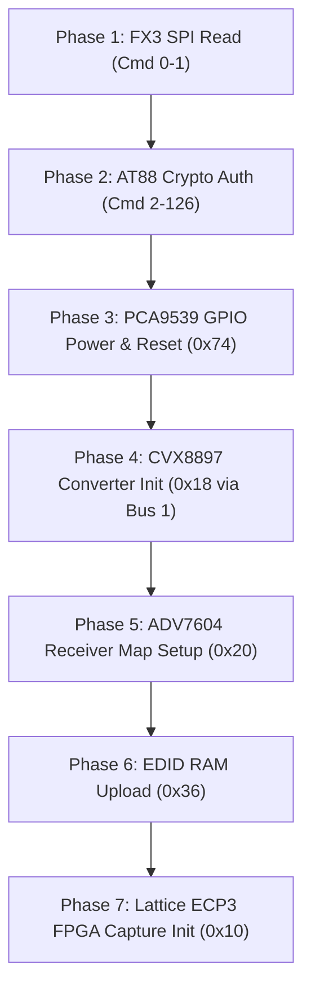

# Reverse-Engineering the CV710 Bootstrap Sequence: Complete Protocol Analysis

The bootstrap sequence (`avmcv710-bootstrap.h`) replays 871 EP1 commands (841 writes, 4495 payload bytes) to initialize the Cypress FX3 microcontroller, Analog Devices ADV7604 HDMI receiver, Lattice ECP3 FPGA, PCA9539 GPIO expander, and CVX8897 frame-rate converter.

Through disassembly and static analysis of the vendor driver (`libC877Driver.dylib`, Mach-O 32-bit i386 with intact symbol table), **100% of the opcodes and commands in this sequence have been identified and mapped to their exact functions.**

---

## 1. Cypress FX3 Control Protocol (EP1 OUT / IN)

All control transactions communicate with the Cypress FX3 ARM9 firmware via USB bulk endpoint `0x01` (OUT) and `0x81` (IN).

The command structure dispatched in `Fx3Firmware::sendCommand`:

| Opcode | Method in `libC877Driver.dylib` | Function | Command Layout |
|:---:|---|---|---|
| `0x01` | `Fx3Firmware::I2cWrite` (bus=0) | I2C Bus 0 Write | `01 <slave7> <len> <reg> <data...>` |
| `0x02` | `Fx3Firmware::I2cWriteThenRead` (bus=0) | I2C Bus 0 Read | `02 <slave7> <wlen> <rlen> <reg>` (data on EP1 IN) |
| `0x03` | `Fx3Firmware::I2cWrite` (bus=1) | I2C Bus 1 Write (CVX8897) | `03 <slave7> <len> <reg> <data...>` |
| `0x04` | `Fx3Firmware::I2cWriteThenRead` (bus=1) | I2C Bus 1 Read (CVX8897) | `04 <slave7> <wlen> <rlen> <reg>` (data on EP1 IN) |
| `0x05` | `Fx3Firmware::AT88SendCmd` | Atmel AT88 CryptoMemory Command | `05 <at88_cmd...>` |
| `0x06` | `Fx3Firmware::AT88RevData` | Atmel AT88 CryptoMemory Receive | `06 <len>` (data read on EP1 IN) |
| `0x07` | `Fx3Firmware::AT88SendData` | Atmel AT88 CryptoMemory Send | `07 <data...>` |
| `0x08` | `Fx3Firmware::AT88PowerOn` | Atmel AT88 CryptoMemory Power On | `08` |
| `0x09` | `Fx3Firmware::AT88WaitClock` | Atmel AT88 CryptoMemory Clock Delay | `09 <clock_ticks>` |
| `0x0D` | `Fx3Firmware::SPIWrite` | SPI Flash Page Write | `0d <cs> <cmd> <addr2> <addr1> <addr0> <data...>` |
| `0x0E` | `Fx3Firmware::SPIRead` | SPI Flash Read | `0e <cs> <cmd> <addr2> <addr1> <addr0> <len>` |
| `0x0F` / `0x10` | `Fx3Firmware::SPIErase` | SPI Flash Sector / Chip Erase | `0f <cs> <cmd> <addr...>` |
| `0x14` | `Fx3Firmware::resetStreamDMA` | Reset FX3 GPIF II Stream DMA FIFO | `14` |

---

## 2. The "Opaque Head": Atmel AT88SC CryptoMemory Authentication

The initial 127 commands contain high-entropy payload blocks that previously appeared to be an unknown configuration.

### Discovery & Identification:
The vendor board contains an **Atmel AT88SC series CryptoAuthentication EEPROM chip** (e.g. AT88SC0204CA or AT88SA102S) connected to the FX3. This chip provides hardware copy protection: during initialization, the host verifies that the hardware is a genuine AVerMedia device before turning on the power rails and streaming logic.

1. **Opcode `0x08` (Command #2):** Calls `Fx3Firmware::AT88PowerOn()`, asserting power to the crypto chip.
2. **Commands `0x05`, `0x06`, `0x07`, `0x09` (Commands #9 to #126):**
   - `0xB6`: AT88 `ReadConfigZone` / `ReadUserZone`
   - `0xB8`: AT88 `VerifyPassword` / `Authenticate` challenge-response
   - `0xBA`: AT88 `CalculateChecksum` / `SetCryptoSeed`
3. **The 268-byte Payload:** Contains the cryptographic challenge, seed, and authentication vectors.
4. **Driver Bypassing:** In `libC877Driver.dylib`, `Device::CryptoCheckSecureID` merely checks if the session authentication completed. Because the fast-start replay reproduces the exact challenge-response bytes from the recorded session, the on-board AT88 chip verifies the handshake and allows the device to operate.

---

## 3. Seven Execution Phases of the Bootstrap

The 871 commands break down into 7 distinct sequential phases:

### Phase 1: FX3 SPI Flash Read (Commands 0–1)
- `0e 02 07 fe 02 00`: Reads 512 bytes of firmware descriptor / board configuration from FX3 external SPI flash.

### Phase 2: AT88 Hardware Authentication Handshake (Commands 2–126)
- Powers on the AT88 chip (`0x08`), sets PCA9539 GPIO power pins (`0x74`), runs mutual authentication handshake (`0xB8`), and clocks crypto calculations (`0x09 0x0a`).

### Phase 3: PCA9539 GPIO Expander Configuration (Slave `0x74`)
- Configures Port 0 as all outputs (`reg 0x06 = 0x00`) and Port 1 (`reg 0x07 = 0x09`).
- Toggles pin states on Output Port 0 (`reg 0x02`):
  - Bit 0: Power rail 1 enable
  - Bit 1: Power rail 2 enable
  - Bit 2: ADV7604 hardware reset (active low)
  - Bit 3: CVX8897 output enable
  - Bit 4: CVX8897 hardware reset pulse

### Phase 4: CVX8897 Frame-Rate Converter Initial Setup (I2C Bus 1, Slave `0x18`)
- Written using opcode `0x03` (`I2C Bus 1 Write`):
  - Programs `0x18` registers `0x03`, `0x04`, `0x05`, `0x06`, `0x0B`, `0x08`, `0x09`, `0x0C`, `0x15`, `0x18`, `0x0F`, `0x16`, `0x10`, `0x13`.
  - Sets default passthrough PLL clocks and bus interface parameters.

### Phase 5: Analog Devices ADV7604 Receiver Initialization
- Total 613 I2C writes across the ADV7604 register maps:
  1. **Remap Sub-Maps (IO map `0x20`):**
     - `0xF4` = `0x80`: CP map -> slave `0x22` (`0x44` 8-bit)
     - `0xF5` = `0x7C`: Sub-map 1
     - `0xF8` = `0x4C`: Repeater/KSV map -> slave `0x26` (`0x4C` 8-bit)
     - `0xF9` = `0x64`: VDP map -> slave `0x32` (`0x64` 8-bit)
     - `0xFA` = `0x68`: HDMI map -> slave `0x34` (`0x68` 8-bit)
     - `0xFB` = `0x6C`: EDID map -> slave `0x36` (`0x6C` 8-bit)
  2. **Power & Core Setup (IO map `0x20`):**
     - `0x00 = 0x08`: Video standard = HDMI-GR (graphics / auto detect)
     - `0x01 = 0x06`: Primary mode = HDMI-GR
     - `0x02 = 0xFC`: Power-up all cores, ADCs, PLLs, and clock inputs
     - `0x05 = 0x2C`: Auto sync polarity, free run enable
     - `0x0B = 0x44`, `0x0C = 0x40`: Output pin tristate control
  3. **HDMI Equalizer & PLL Initialization (HDMI map `0x34`):**
     - Emits `RxPllInitTable` (regs `0x3D`, `0x3E`, `0x4E`)
     - Emits `RxEqInitTable` (regs `0x01`, `0x02`, `0x03`, `0x9D`)
     - `0x01 = 0x78`: Enables 50-ohm internal TMDS termination
     - `0x5A = 0x08`: Audio FIFO reset and clock recovery loop filter
  4. **Component Processor & Color Space (CP map `0x22`):**
     - Sets up color space conversion matrices (regs `0x68`, `0x69`, `0x85`)
     - Programs clamp/gain controls (`0x3A`..`0x41`, `0xCF`)
     - Configures saturation/contrast (`0x8B`, `0x91`)

### Phase 6: EDID Upload (Slave `0x36`)
- 8 writes of 32 bytes = 256 bytes total written to internal EDID RAM (`0x36`).
- Identical to `avmu3_x64.sys` offset `0xd9fb0` and `libC877Driver.dylib` offset `0x4669c`.
- Advertises 1080p60, 1080i60, 720p60, 576p50, 480p60, and PCM 2-channel 32/44.1/48 kHz audio.

### Phase 7: Lattice ECP3 FPGA Capture Configuration (Slave `0x10`)
- Slave `0x10` registers:
  - `0x05 = 0x00`: Puts FPGA in idle mode during configuration.
  - `0x01`, `0x02`, `0x06`: Programs FIFO watermarks and DMA packet lengths.
  - `0x80`..`0x86`: Internal serialization clocks.
- The stream is now primed. When streaming begins, `avm_fpga_work_mode(dev, true)` writes `0x10/0x05 = 0x02` (bit 1 = 1) to start bulk transfers on EP `0x83`.
